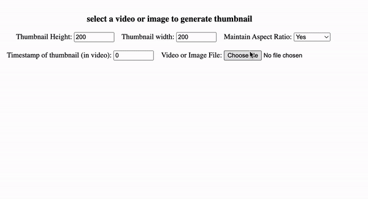

[](https://www.npmjs.com/package/browser-thumbnail-generator)
[](https://github.com/abhishekjnvk/browser-thumbnail-generator)
[](https://www.typescriptlang.org/)
[]()

# browser-thumbnail-generator

A simple and efficient library for generating thumbnails from images and videos in the browser. Zero dependencies, written in TypeScript, with full ESM/CJS support.

## Demo

[Live Preview](https://browser-thumbnail.netlify.app/)



## Features

- Generate thumbnails from images (JPEG, PNG, GIF, BMP, WebP, SVG)
- Generate thumbnails from videos (MP4, WebM, OGG, MOV, AVI, and more)
- Maintain or override aspect ratio
- Choose output format (JPEG, PNG, WebP) and quality
- Cancel operations with `AbortSignal`
- Full TypeScript support with type definitions
- Tree-shakeable ESM and CJS builds
- Comprehensive input validation

## Installation

```bash
npm install browser-thumbnail-generator
```

```bash
yarn add browser-thumbnail-generator
```

```bash
pnpm add browser-thumbnail-generator
```

## Usage

### Basic usage

```ts
import generateMediaThumbnail from "browser-thumbnail-generator";

const result = await generateMediaThumbnail({
  file: imageFile,       // File or Blob
  width: 200,
  height: 200,
});

const thumbnailUrl = URL.createObjectURL(result.thumbnail);
```

### All options

```ts
import generateMediaThumbnail, { type ThumbnailOptions } from "browser-thumbnail-generator";

const options: ThumbnailOptions = {
  file: videoFile,           // File | Blob (required)
  width: 320,                // number — desired thumbnail width (optional)
  height: 240,               // number — desired thumbnail height (optional)
  maintainAspectRatio: true, // boolean — keep original aspect ratio (default: true)
  timestamp: 5,              // number — video seek time in seconds (default: 0, video only)
  outputFormat: "image/webp",// "image/jpeg" | "image/png" | "image/webp" (default: "image/jpeg")
  quality: 0.8,              // number — 0 to 1, for lossy formats (optional)
  signal: abortController.signal, // AbortSignal — cancel the operation (optional)
};

const result = await generateMediaThumbnail(options);
```

### Cancelling a request

```ts
const controller = new AbortController();

// Cancel after 2 seconds
const timeout = setTimeout(() => controller.abort(), 2000);

try {
  const result = await generateMediaThumbnail({ file, signal: controller.signal });
  clearTimeout(timeout);
} catch (err) {
  if (err.name === "AbortError") {
    console.log("Thumbnail generation was cancelled");
  }
}
```

### Error handling

```ts
import generateMediaThumbnail from "browser-thumbnail-generator";

try {
  const result = await generateMediaThumbnail({ file });
} catch (err) {
  // TypeError: input validation errors (missing file, invalid dimensions, etc.)
  // Error: unsupported file type, failed to load media, encoding failure, etc.
  // DOMException (AbortError): operation was cancelled
  console.error(err);
}
```

## API

### `generateMediaThumbnail(options)`

Returns `Promise<ThumbnailResult>`.

#### Options

| Option | Type | Default | Description |
|---|---|---|---|
| `file` | `File \| Blob` | **required** | The image or video file |
| `width` | `number` | original width | Desired thumbnail width in pixels |
| `height` | `number` | original height | Desired thumbnail height in pixels |
| `maintainAspectRatio` | `boolean` | `true` | Maintain the original aspect ratio when resizing |
| `timestamp` | `number` | `0` | Video seek time in seconds (video only) |
| `outputFormat` | `"image/jpeg" \| "image/png" \| "image/webp"` | `"image/jpeg"` | Output image format |
| `quality` | `number` | browser default | Output quality for lossy formats (0–1) |
| `signal` | `AbortSignal` | — | Cancel the operation |

#### Result

| Property | Type | Description |
|---|---|---|
| `thumbnail` | `Blob` | The generated thumbnail image |
| `width` | `number` | Thumbnail width in pixels |
| `height` | `number` | Thumbnail height in pixels |
| `size` | `number` | Thumbnail file size in bytes |
| `original_size` | `number` | Original file size in bytes |
| `original_width` | `number` | Original media width in pixels |
| `original_height` | `number` | Original media height in pixels |
| `total_duration` | `number?` | Video duration in seconds (video only) |
| `timestamp` | `number?` | Captured timestamp in seconds (video only) |

### `supportedMimeTypes`

Array of all supported MIME types for the `accept` attribute of file inputs.

```ts
import { supportedMimeTypes } from "browser-thumbnail-generator";

<input type="file" accept={supportedMimeTypes.join(",")} />
```

Also available: `supportedImageMimes`, `supportedVideoMimes`.

### Type exports

```ts
import type { ThumbnailOptions, ThumbnailResult, OutputFormat } from "browser-thumbnail-generator";
```

## Browser Support

Requires a browser with Canvas and `URL.createObjectURL` support. `requestVideoFrameCallback` is used when available for more reliable video frame capture (Chrome 83+, Edge 83+).

## Development

```bash
# Install dependencies
npm install

# Build (ESM + CJS + type definitions)
npm run build

# Run tests
npm test

# Run tests in watch mode
npm run test:watch

# Lint
npm run lint

# Type check
npm run typecheck
```

## Contributing

Contributions are welcome! Please open an issue or submit a pull request on GitHub.

## License

[MIT](./LICENSE)

## Author

[Abhishek Kumar](https://github.com/abhishekjnvk) ([Blog](https://codecave.abhishekjnvk.in/))
